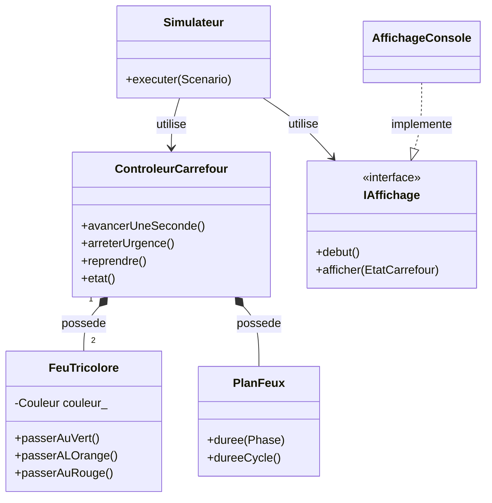

# Comprendre l'architecture orientée objet

Le programme représente des éléments concrets par des objets. Chaque objet garde
son état et expose les opérations autorisées. Les composants regroupent ensuite
ces objets selon leur rôle dans l'application.

## Les classes et leurs relations



Le losange représente la **composition** : les feux appartiennent au contrôleur.
La flèche vers `IAffichage` représente une dépendance à une interface. La relation
d'implémentation permet au simulateur d'utiliser différents affichages.

| Classe | État possédé | Opérations utiles |
| --- | --- | --- |
| `FeuTricolore` | Nom et couleur | Changer de couleur selon les transitions autorisées |
| `PlanFeux` | Durées des quatre types d'intervalle | Donner la durée d'une phase ou du cycle |
| `ControleurCarrefour` | Deux feux, plan, phase, compteur, urgence | Avancer, arrêter, reprendre, observer |
| `Scenario` | Durée et événements optionnels | Fournir un scénario validé |
| `Simulateur` | Références au contrôleur et à l'affichage | Appliquer le scénario en temps virtuel |
| `AffichageConsole` | Référence vers un flux de sortie | Écrire les observations en CSV |
| `OptionsLigneCommande` | Aucun état durable | Transformer les arguments en objets valides |

`Couleur` et `Phase` sont des `enum class` : leurs valeurs sont nommées et typées.
`EtatCarrefour` est une structure de données destinée à l'observation.
`Options` rassemble le plan, le scénario et la demande d'aide après lecture de la CLI.

## Encapsulation : protéger l'état

Dans `FeuTricolore`, `couleur_` est privée. Un appelant demande une transition :

```cpp
feux::FeuTricolore feu{"Nord-Sud"};
feu.passerAuVert();
feu.passerALOrange();
feu.passerAuRouge();
```

Une demande d'orange depuis le rouge est refusée avec `std::logic_error`.
Le retour forcé au rouge reste possible pour l'urgence. Le contrôleur possède ses
deux feux dans ses membres privés ; il n'en fournit aucune référence modifiable.
Un autre composant ne peut donc pas allumer un axe en contournant la coordination.

`etat()` renvoie une copie. Modifier cette copie ne change pas les feux.
`PlanFeux` et `Scenario` valident leurs durées à la construction et ne proposent
pas de setters : une configuration incohérente n'est pas installée partiellement.

## Composition : assembler des objets

Un `ControleurCarrefour` contient deux `FeuTricolore` et un `PlanFeux`.
Ce n'est pas une spécialisation d'un feu : il coordonne plusieurs feux.
L'héritage n'est donc pas utilisé entre ces classes.

Le contrôleur conserve la phase du cycle et son temps restant. À chaque seconde,
il décrémente ce compteur et passe à la phase suivante si le compteur atteint zéro.
Pendant une urgence, le temps global avance mais le cycle ne progresse plus.
Le champ `phase` du relevé interne conserve alors la dernière phase normale ; le
champ `urgence` indique la suspension. L'affichage présente la phase `URGENCE`.

## Polymorphisme : remplacer l'affichage

`Simulateur` reçoit une référence vers `IAffichage` :

```cpp
class IAffichage {
public:
    virtual ~IAffichage() = default;
    virtual void debut() = 0;
    virtual void afficher(const EtatCarrefour& etat) = 0;
};
```

Le `= 0` rend une méthode virtuelle pure : chaque affichage concret doit fournir
son implémentation. `AffichageConsole` écrit dans un `std::ostream`. Le collecteur
des tests range les états dans un `std::vector`. Les deux satisfont le même contrat.

`override` indique que la méthode implémente celle de l'interface et permet au
compilateur de vérifier sa signature. Le destructeur virtuel permet une destruction
correcte via l'interface si une évolution du projet utilise ce mode de possession.

## Injection des dépendances et durée de vie

Les dépendances sont passées au constructeur :

```cpp
feux::ControleurCarrefour controleur{feux::PlanFeux{6, 4, 2, 1}};
feux::AffichageConsole affichage{std::cout};
feux::Simulateur simulateur{controleur, affichage};
simulateur.executer(feux::Scenario{20, 3, 6});
```

Le simulateur ne construit pas lui-même une console. Il peut donc fonctionner
avec un autre affichage. Ici, les objets sont locaux à `main`, sans `new` ni `delete`.
Ils sont détruits automatiquement dans l'ordre inverse de leur construction ;
le contrôleur et l'affichage restent vivants tant que le simulateur les utilise.

## Les composants à la compilation

| Cible CMake | Sources | Dépendance déclarée |
| --- | --- | --- |
| `feux_domaine` | `src/domaine/*.cpp` | Bibliothèque standard C++ |
| `feux_simulation` | `src/simulation/*.cpp` | `feux_domaine` |
| `feux_console` | `src/console/*.cpp` | `feux_simulation` |
| `feux_tricolores` | `src/main.cpp` | `feux_console` |

Les dépendances publiques sont propagées par CMake. La logique du domaine n'a
aucune dépendance vers l'affichage console. Les tests C++ sont eux-mêmes séparés
par composant dans `tests/unit/` et utilisent la bibliothèque qu'utilise l'application.

## Où intervenir pour une évolution

| Besoin | Point de modification |
| --- | --- |
| Ajuster les durées d'un scénario | Arguments de CLI, sans modifier les classes |
| Modifier l'ordre des passages | `ControleurCarrefour` et tests de séquence |
| Ajouter un affichage graphique ou un export différent | Nouvelle implémentation d'`IAffichage` |
| Ajouter plusieurs arrêts et reprises | `Scenario`, `Simulateur` et lecteur d'options |
| Ajouter une commande piétonne | Nouvelle règle et nouveau composant du domaine, avec tests |

Cette V3 n'ajoute pas encore de voitures, de capteurs ou de passage piéton.
Sa séparation en composants fournit des points d'extension pour les exercices suivants.

Références de construction : [liaison des cibles CMake](https://cmake.org/cmake/help/v3.31/command/target_link_libraries.html),
[CTest et rapports](https://cmake.org/cmake/help/v3.31/manual/ctest.1.html),
[publication JUnit dans Jenkins](https://www.jenkins.io/doc/pipeline/steps/junit/).
